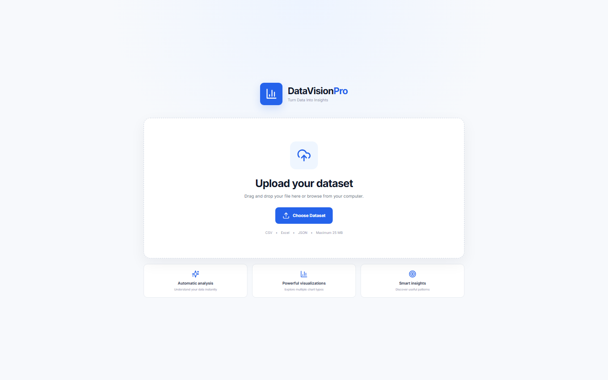
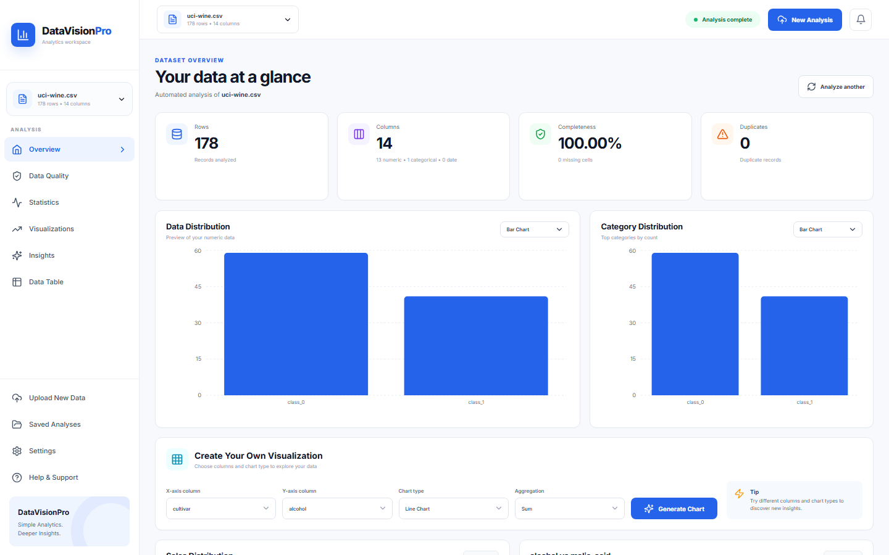
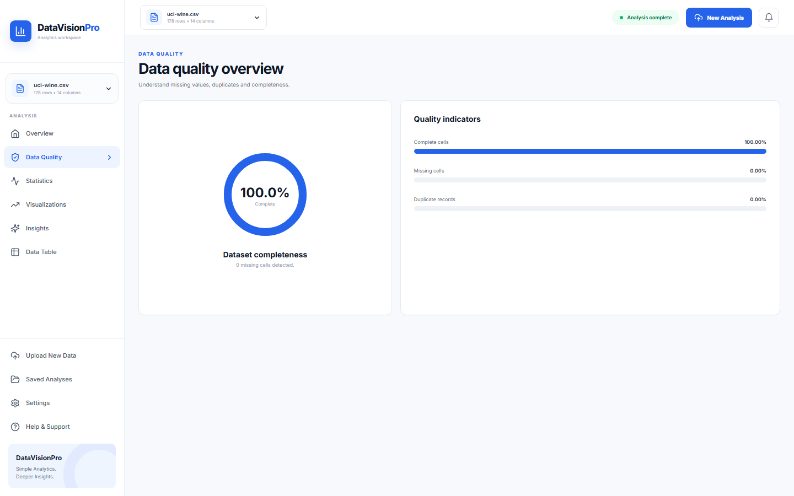
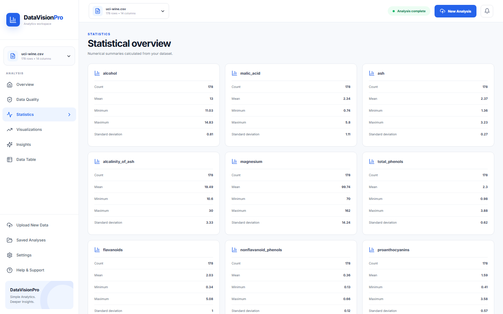
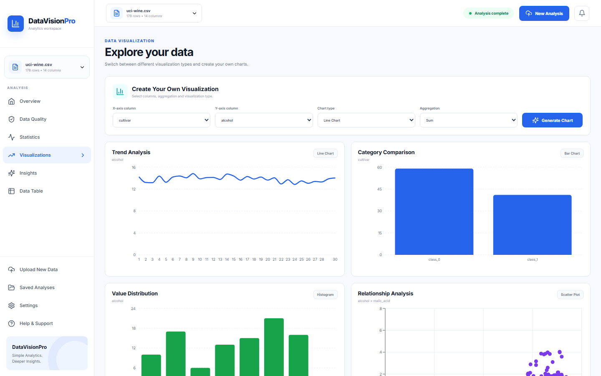
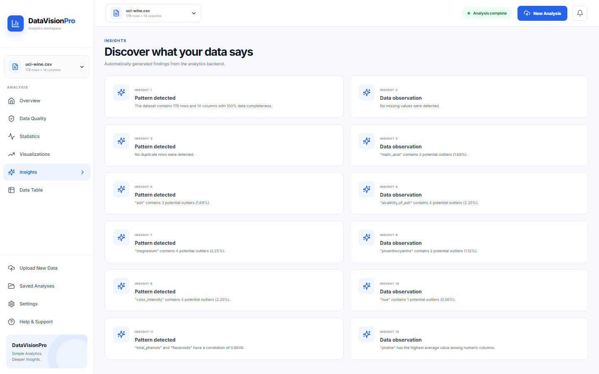
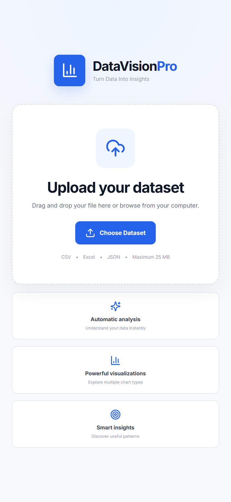
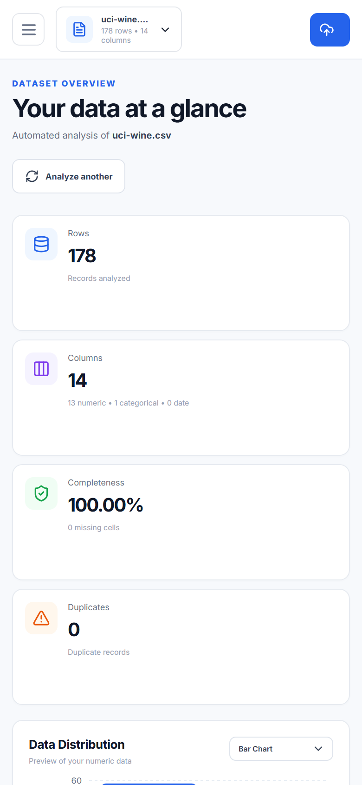

<div align="center">

# 📊 DataVisionPro

**Upload your data. Analyze it. Visualize it. Understand it.**

A full-stack data analytics and visualization platform that turns raw datasets into meaningful statistics, interactive charts, data-quality reports, correlations, outlier analysis, and automated insights — all through a clean, easy-to-use interface.

[](https://datavision-pro-1.onrender.com/)
[](https://github.com/nvaltryek-001/DataVision-Pro)

**[🌐 Live Demo](https://datavision-pro-1.onrender.com/)** · **[💻 GitHub](https://github.com/nvaltryek-001/DataVision-Pro)** · **[🐛 Report a Bug](https://github.com/nvaltryek-001/DataVision-Pro/issues)**

</div>

---

## 🎬 Demo

<p align="center">
  <a href="docs/demo/DataVision-Pro-demo.mp4"></a>
  <br/><sub>Real recording of the app running locally (<code>npm run server</code> + <code>npm run dev</code>) analysing the public
  <a href="https://archive.ics.uci.edu/dataset/109/wine">UCI Wine dataset</a> (178 rows × 14 columns, exported from scikit-learn). <a href="docs/demo/DataVision-Pro-demo.mp4">Watch the MP4</a>.</sub>
</p>

## 📸 Screenshots

| Upload | Overview |
|---|---|
|  |  |
| **Data quality** | **Statistics** |
|  |  |
| **Visualizations** | **Insights** |
|  |  |

| Mobile — upload | Mobile — overview |
|---|---|
|  |  |

More: [data table](docs/screenshots/desktop-data-table.png)

---

## 📑 Table of Contents

- [About](#-about)
- [Why DataVisionPro](#-why-datavisionpro)
- [Features](#-features)
- [Tech Stack](#️-tech-stack)
- [Project Structure](#-project-structure)
- [REST API](#-rest-api)
- [Getting Started](#-getting-started)
- [Environment Variables](#️-environment-variables)
- [Dataset Compatibility](#-dataset-compatibility)
- [Security & Data Privacy](#-security--data-privacy)
- [Testing Checklist](#-testing-checklist)
- [Target Users](#-target-users)
- [Roadmap](#-roadmap)
- [Contributing](#-contributing)
- [License](#-license)

---

## 📌 About

Exploratory Data Analysis (EDA) usually means writing code just to clean data, compute statistics, spot missing values, detect outliers, and build charts before you can actually interpret anything.

**DataVisionPro turns that entire workflow into a single upload.**

Once a dataset is uploaded, users instantly get:

| | | |
|---|---|---|
| 📊 Dataset overview | 🔍 Column information | 🧹 Data quality report |
| 📈 Statistical analysis | 🚨 Outlier detection | 🔗 Correlation analysis |
| 📉 Interactive visualizations | 💡 Automated insights | 📋 Dataset preview |

Built for **students, analysts, researchers, developers, and business users** who want fast insight without writing analysis code from scratch.

---

## 🌟 Why DataVisionPro?

**The traditional way:**

```
Dataset → Write Code → Clean Data → Calculate Stats → Find Missing
Values → Find Outliers → Create Charts → Analyze Correlations → Interpret
```

**The DataVisionPro way:**

```
                     📂 Upload Dataset
                            │
                    🔍 Automatic Analysis
                            │
          ┌─────────────────┼─────────────────┐
          │                 │                 │
      🧹 Quality        📊 Statistics     🚨 Outliers
          │                 │                 │
          └─────────────────┼─────────────────┘
                            │
                    🔗 Correlations
                            │
                    📈 Visualizations
                            │
                      💡 Insights
                            │
                    📋 Data Preview
```

---

## ✨ Features

### 📤 Multi-Format Upload
Supports **CSV, XLSX, XLS, and JSON** — up to **25 MB** per file.

### 🔍 Automatic Dataset Profiling
Instantly detects rows, columns, numeric/categorical/date columns, missing values, duplicate rows, and overall completeness.

### 📊 Statistical Analysis
Auto-computed metrics for numeric variables: count, mean, median, min, max, standard deviation, percentiles, unique values, and distribution info.

### 🧹 Data Quality Analysis

```
                 Dataset
                    │
             ┌──────┴───────┐
             │  Data Quality │
             └──────┬───────┘
                    │
      ┌─────────────┼─────────────┐
  ❌ Missing    🔁 Duplicates   📊 Data Types
      │             │             │
      └─────────────┼─────────────┘
                     │
              📈 Completeness
```

### 🚨 Outlier Detection
Flags extreme values, unusual observations, likely data-entry errors, and potential anomalies.

### 🔗 Correlation Analysis
Identifies positive, negative, weak, and strong relationships between numeric variables, visualized as a correlation heatmap.

```
        A      B      C      D
A      1.0    0.8   -0.2    0.1
B      0.8    1.0   -0.4    0.3
C     -0.2   -0.4    1.0    0.6
D      0.1    0.3    0.6    1.0
```

### 📈 Interactive Visualization Studio

| Chart | Purpose |
|---|---|
| 📈 Line | Trends over ordered data |
| 📊 Bar | Compare categories |
| 📉 Area | Trends and magnitude |
| 🥧 Pie / 🍩 Donut | Category proportions |
| 📊 Histogram | Numeric distribution |
| 🔵 Scatter | Relationship between variables |
| 📦 Box Plot | Distribution and outliers |
| 🔥 Heatmap | Numeric relationships |

### 💡 Automated Insights
Surfaces key observations automatically — moving users from *"what's inside my dataset?"* to *"what can I understand from my dataset?"*

### 📋 Data Preview
A live preview table keeps the raw dataset visible alongside the analysis.

### 🎨 Clean Analytics Dashboard
Everything organized into: **Overview · Data Quality · Statistics · Visualizations · Insights · Data Table**

---

## 🏗️ System Architecture

```
                         👤 USER
                           │
                           ▼
                ┌────────────────────┐
                │      🌐 Browser     │
                │   React + Vite UI  │
                └─────────┬──────────┘
                          │ HTTP / REST API
                          ▼
                ┌────────────────────┐
                │    ⚙️ Express API   │
                │   Node.js Backend  │
                └─────────┬──────────┘
                          ▼
                ┌────────────────────┐
                │ 📂 File Processing │
                │  CSV / Excel / JSON│
                └─────────┬──────────┘
                          ▼
                ┌────────────────────┐
                │ 🧠 Analysis Engine │
                │ Stats · Quality    │
                │ Outliers · Corr.   │
                │ Insights           │
                └─────────┬──────────┘
                          ▼
                ┌────────────────────┐
                │  📦 JSON Response   │
                └─────────┬──────────┘
                          ▼
                ┌────────────────────┐
                │  📊 Analytics UI    │
                │ Charts · Tables    │
                └────────────────────┘
```

**Production deployment:**

```
                       ☁️ GitHub
                          │
             ┌────────────┴────────────┐
             ▼                         ▼
    🌐 Render Static Site       ⚙️ Render Web Service
       (React + Vite)             (Node + Express)
             │                         │
             └────────────┬────────────┘
                        REST API
                          │
                          ▼
                  📊 Data Analysis
```

---

## 🛠️ Tech Stack

### Frontend
| Technology | Purpose |
|---|---|
| ⚛️ React | User interface |
| ⚡ Vite | Build tooling |
| 📊 Recharts | Data visualization |
| 🎨 Tailwind CSS | Styling |
| 🧩 Lucide React | Icons |

### Backend
| Technology | Purpose |
|---|---|
| 🟢 Node.js | Runtime |
| 🚂 Express.js | REST API |
| 📦 Multer | File uploads |
| 📊 SheetJS / XLSX | Excel processing |
| 🔗 CORS | Cross-origin requests |

### Deployment
| Technology | Purpose |
|---|---|
| 🐙 GitHub | Source control |
| ☁️ Render | Production hosting |

---

## 📁 Project Structure

```
DataVision-Pro/
├── server/
│   └── server.js
├── src/
│   ├── App.jsx
│   ├── main.jsx
│   └── index.css
├── index.html
├── package.json
├── package-lock.json
├── vite.config.js
├── tailwind.config.js
├── postcss.config.js
├── .gitignore
└── README.md
```

---

## 🔌 REST API

### ❤️ Health Check

```http
GET /api/health
```

**Response**

```json
{
  "status": "ok",
  "service": "DataVisionPro API",
  "version": "1.0.0",
  "timestamp": "..."
}
```

### 📤 Analyze Dataset

```http
POST /api/analyze
```

Accepts a `multipart/form-data` request with a `file` field. Supports `.csv`, `.xlsx`, `.xls`, `.json`.

**Response**

```json
{
  "success": true,
  "data": {
    "overview": {},
    "columns": [],
    "numericColumns": [],
    "categoricalColumns": [],
    "dateColumns": [],
    "columnAnalysis": {},
    "correlations": [],
    "outliers": [],
    "insights": [],
    "preview": []
  }
}
```

---

## 💻 Getting Started

### Prerequisites

- 🟢 Node.js 18+
- 📦 npm
- 🐙 Git

### 1. Clone the repository

```bash
git clone https://github.com/nvaltryek-001/DataVision-Pro.git
cd DataVision-Pro
```

### 2. Install dependencies

```bash
npm install
```

### 3. Start the backend

```bash
npm run server
```

Runs on `http://localhost:5000` — health check at `/api/health`.

### 4. Start the frontend

In a separate terminal:

```bash
npm run dev
```

Open the Vite URL shown in your terminal.

### 5. Production build

```bash
npm run build      # create production build
npm run preview    # preview the build
```

---

## ⚙️ Environment Variables

```env
VITE_API_URL=http://localhost:5000
```

For production:

```env
VITE_API_URL=https://your-backend-url.onrender.com
```

---

## 📊 Dataset Compatibility

DataVisionPro works with structured/tabular data. Example:

```csv
Product,Category,Sales,Quantity,Date
Laptop,Electronics,75000,3,2026-01-10
Phone,Electronics,45000,5,2026-01-11
Chair,Furniture,12000,8,2026-01-12
Table,Furniture,25000,4,2026-01-13
Book,Education,5000,20,2026-01-14
```

**Great candidates for testing:**

| Category | Examples |
|---|---|
| 📊 Business | Sales, customer, product, revenue datasets |
| 🎓 Education | Student performance, attendance, exam results |
| 🔬 Research | Experimental data, measurements, observations |
| 📈 Analytics | Financial data, time-series, survey data |

---

## 🔐 Security & Data Privacy

- No user registration or login required
- No database needed for normal analysis
- Files are processed **in-memory** on the backend

> ⚠️ **Do not upload** confidential or sensitive data — credentials, API keys, private company data, or personal/medical/financial information — unless you fully understand the deployment environment.

Never commit API keys, passwords, tokens, or secrets to GitHub.

---

## 🧪 Testing Checklist

<details>
<summary>Click to expand</summary>

**Upload**
- [x] CSV · [x] XLSX · [x] XLS · [x] JSON

**Analysis**
- [x] Row/column count · [x] Data types · [x] Numeric/categorical/date columns

**Data Quality**
- [x] Missing values · [x] Duplicate records · [x] Completeness

**Statistics**
- [x] Mean · [x] Median · [x] Min/Max · [x] Std deviation

**Advanced**
- [x] Outliers · [x] Correlations

**Visualization**
- [x] Line · [x] Bar · [x] Area · [x] Pie · [x] Donut · [x] Histogram · [x] Scatter · [x] Box Plot · [x] Heatmap

**Deployment**
- [x] Frontend · [x] Backend · [x] Production API

</details>

---

## 🎯 Target Users

| Who | Benefit |
|---|---|
| 👨‍🎓 Students | Learn data analysis without heavy coding |
| 📊 Data Analysts | Fast initial exploratory analysis |
| 🔬 Researchers | Explore data before deeper modeling |
| 👨‍💻 Developers | Quickly inspect structured datasets |
| 🏢 Business Users | Understand sales, customer, and ops data |

---

## 🔮 Roadmap

- ✅ **Phase 1 — Core Platform** *(complete)* — upload, profiling, statistics, outliers, correlations, insights, charts, deployment
- 🟡 **Phase 2 — Data Cleaning** — missing-value handling, duplicate removal, transformations, cleaned-dataset download
- 🟠 **Phase 3 — Reporting** — PDF/EDA reports, chart & analysis export
- 🔵 **Phase 4 — AI-Assisted Analytics** — natural-language questions, AI-generated explanations, chart recommendations
- 🟣 **Phase 5 — Advanced Data Science** — regression, classification, clustering, forecasting, ML workflows
- 🔴 **Phase 6 — Platform** — user accounts, saved projects, dashboard sharing, team collaboration

**Preview of Phase 4:**

> **User:** "Which column has the strongest relationship with sales?"
> **DataVisionPro AI:** "Revenue has the strongest positive correlation with sales, with a correlation coefficient of ..."

---

## 🤝 Contributing

1. Fork the repository
2. Clone your fork: `git clone https://github.com/YOUR_USERNAME/DataVision-Pro.git`
3. Create a feature branch: `git checkout -b feature/your-feature`
4. Make your changes and test them
5. Commit: `git commit -m "Add your feature"`
6. Push: `git push origin feature/your-feature`
7. Open a Pull Request

### 🐛 Reporting Bugs

Please open a [GitHub Issue](https://github.com/nvaltryek-001/DataVision-Pro/issues) including: problem description, dataset format/size, steps to reproduce, expected vs. actual behavior, browser/OS, and a screenshot if possible.

---

## 📄 License

This project currently does not declare an open-source license. If you intend to distribute or reuse this project, please add an appropriate `LICENSE` file.

---

<div align="center">

### 🚀 Upload your data. Understand your data.

Built with ❤️ using React, Node.js, Express, and Recharts.

**[🌐 Live Demo](https://datavision-pro-1.onrender.com/)** · **[⭐ Star on GitHub](https://github.com/nvaltryek-001/DataVision-Pro)**

</div>
